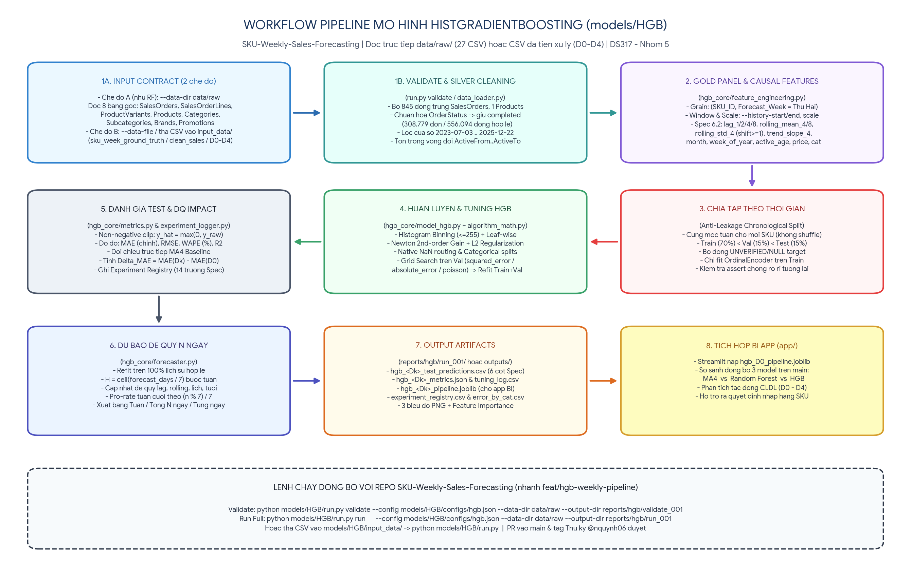

# Tài liệu Workflow Pipeline Mô hình HistGradientBoosting (`models/HGB`)

> **Dự án:** `SKU-Weekly-Sales-Forecasting` (DS317 – Nhóm 5)  
> **Nhánh phát triển:** `feat/hgb-weekly-pipeline` → Pull Request vào `main` (Reviewer: Thư ký `@nquynh06`)

---

## 1. Hình ảnh Workflow tổng thể

---

## 2. Đầu vào (Input Files & Tables Contract)

Pipeline `models/HGB/run.py` đồng bộ 100% chuẩn CLI với `models/random forest/run.py` trong `README.md` (Mục 9E) và hỗ trợ **2 chế độ đầu vào**:

### Chế độ A — Đọc trực tiếp `data/raw/` (giống Random Forest, không cần chạy lại `joined_sales_data.csv`)
| Mức độ | Bảng CSV trong `data/raw/` | Khóa & Cột sử dụng | Xử lý theo chuẩn Lab 1–4 |
| :--- | :--- | :--- | :--- |
| **Bắt buộc** | `SalesOrders.csv` | `SalesOrderID`, `OrderDate`, `OrderStatus` | Bỏ 845 dòng trùng hoàn toàn; chuẩn hóa `complete`→`completed`, `canceled`→`cancelled`; chỉ giữ `completed` (308.779 đơn). |
| **Bắt buộc** | `SalesOrderLines.csv` | `SalesOrderLineID`, `SalesOrderID`, `SKU_ID`, `Quantity`, `RegularUnitPrice`, `ActualSellingPrice`, `PromotionID` | Kiểm tra không trùng `SalesOrderLineID`, `Quantity > 0`; JOIN `many_to_one` thu đúng **556.094 dòng bán hợp lệ**; cắt cửa sổ đồng bộ `2023-07-03 → 2025-12-22` (130 tuần, **553.261 dòng**). |
| **Khuyến nghị** | `ProductVariants.csv`, `Products.csv` | `SKU_ID`, `ProductID`, `BrandID`, `SubcategoryID`, `ActiveFrom`, `ActiveTo` | Bỏ 1 dòng trùng `Products`, bỏ 3 cột rỗng 100%; tính `active_age` từ `ActiveFrom` theo vòng đời sản phẩm. |
| **Khuyến nghị** | `Categories.csv`, `Subcategories.csv`, `Brands.csv`, `Promotions.csv` | `CategoryName`, `SubcategoryName`, `BrandName` | Đặc trưng phân loại bản địa (Native Categorical) của HGB và báo cáo lỗi theo ngành hàng. |

### Chế độ B — Đọc trực tiếp file CSV đã tiền xử lý (`--data-file` hoặc thả vào `models/HGB/input_data/`)
Hỗ trợ chạy trực tiếp các file `data/processed/sku_week_ground_truth_provisional.csv`, `data/processed/clean_sales_transactions.csv`, hoặc các bộ thí nghiệm chất lượng dữ liệu `D0`–`D4` (`--run-all-in-input`).

---

## 3. Quy trình xử lý & Kết quả kiểm chứng trên dữ liệu thật (`Electronics Sales Dataset`)

Pipeline đã được chạy kiểm chứng trực tiếp trên **toàn bộ 27 file CSV gốc** (`2023-07-03 → 2025-12-22`, **74,305 dòng SKU–tuần**, **871 SKU**, **130 tuần**):

- **Chia tập theo thời gian (không shuffle):**
  - **Train:** `48,096` mẫu (`2023-07-10 to 2025-03-24`)
  - **Validation:** `12,027` mẫu (`2025-03-31 to 2025-08-04`)
  - **Test (Hold-out):** `13,203` mẫu (`2025-08-11 to 2025-12-22`)
- **Kết quả kiểm chứng thực tế trên tập Test (cấu hình mặc định `--no-tune`, thời gian chạy 79.157s trên CPU):**

| Mô hình | MAE (chính) | RMSE | WAPE (%) | $R^2$ |
| :--- | :---: | :---: | :---: | :---: |
| **MA4 (Baseline tham chiếu)** | `2.7711` | `3.9689` | `33.8199%` | `0.7214` |
| **HistGradientBoosting (HGB)** | **`2.4790`** | **`3.5618`** | **`30.2545%`** | **`0.7756`** |

---

## 4. Đầu ra (Output Artifacts)

| Tệp đầu ra | Mô tả |
| :--- | :--- |
| `validation_report.json` & `validation_checks.csv` | Báo cáo kiểm định contract dữ liệu (sinh bởi lệnh `validate`) |
| `hgb_<Dk>_test_predictions.csv` / `.parquet` | **Đúng 6 cột chuẩn Spec 2.4:** `SKU_ID`, `Forecast_Week`, `Actual_Quantity`, `Predicted_Quantity`, `Model`, `Dataset_Version` |
| `hgb_<Dk>_metrics.json` & `experiment_registry.csv` | Toàn bộ độ đo (`MAE`, `RMSE`, `WAPE_pct`, `R2`, `Delta_MAE_vs_D0`) & nhật ký thực nghiệm 14 trường |
| `hgb_<Dk>_tuning_log.csv` | Bảng kết quả tìm kiếm siêu tham số trên tập Validation |
| `hgb_<Dk>_feature_importance.csv` & `hgb_<Dk>_error_by_category.csv` | Permutation Importance & phân tích sai số theo 8 ngành hàng |
| `hgb_<Dk>_forecast_<n>d_weekly.csv`, `_summary.csv`, `_daily.csv` | Dự báo đệ quy cho `n` ngày tương lai |
| `hgb_<Dk>_pipeline.joblib` & `plot_<Dk>_*.png` | Mô hình đóng gói cho ứng dụng Streamlit (`app/`) & 3 biểu đồ PNG |
